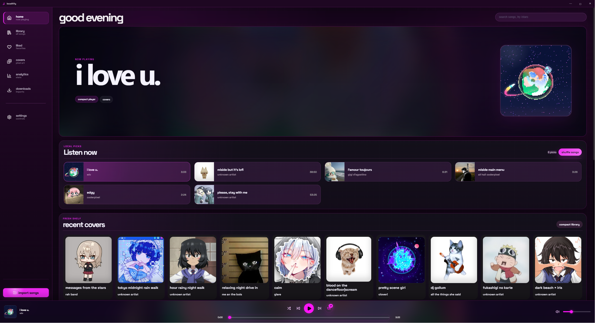

# localtify

**Your music. Your computer.**

A local-first desktop music player with albums, playlists, custom artwork, themes, listening stats, and desktop playback controls. No account or subscription required.

**[Download the latest release](https://github.com/meshahid973/localitfy/releases)**

## Features

- Play and organize local audio with playlists, albums, search, queues, shuffle, and repeat.
- Personalize the player with themes, covers, and a cover studio.
- Import music and use the available YouTube or public Spotify import tools.
- Optional Discord Rich Presence, scrobbling, synchronized lyrics, and MusicBrainz tagging.
- Optional local audio analysis, similarity suggestions, radio, and Daily Mixes.

The app does not stream an online music catalog. Import/download features connect to external services only when you use them.

## Installation

Download a release for your operating system:

| Platform | Package |
| --- | --- |
| Windows | Installer (`.exe`) |
| Linux | AppImage, Debian (`.deb`), or RPM (`.rpm`) |

Open the installed app and import your music. macOS native binaries are tested in CI, but check [Releases](https://github.com/meshahid973/localitfy/releases) for currently published installers.

## Development

Use Node.js 22, npm, and Git.

~~~bash
git clone https://github.com/meshahid973/localitfy.git
cd localitfy
npm ci
npm run dev
~~~

Create a local `.env` from `.env.example` only if you need optional configuration.

| Command | Purpose |
| --- | --- |
| `npm run check` | Type checking, app tests, build, and codebase checks |
| `npm run release:check` | Full validation and performance budgets |
| `npm run dist` | Standard Windows installer |
| `npm run dist:linux` | Standard Linux packages |
| `npm run rust:build` | Build optional native compute kernels |
| `npm run rust:test` | Native/JavaScript parity tests |
| `npm run rust:benchmark` | Compare opt-in kernels with JavaScript |

**Rust kernels are experimental and disabled by default.** The regular installer does not require them. See [Native kernels and release testing](docs/architecture/native-kernels.md) for opt-in settings and packaging.

## Privacy

Your library and audio analysis stay local. Online lyrics, MusicBrainz tagging, downloads/imports, and scrobbling are optional integrations. Enabling a lookup can send song metadata to the corresponding service; a local `.lrc` sidecar file needs no lyrics lookup. MusicBrainz file tagging is applied only after review. Browser-cookie access for downloads is disabled by default.

## Compatibility and source

- `src/` — React/TypeScript renderer and feature modules
- `electron/` — Electron, playback services, SQLite, and the trusted IPC bridge
- `native/` — optional NAPI-RS compute kernels
- `tests/` and `scripts/` — automated validation and development tooling

The repository's historical spelling, `window.localitfy`, `localitfy:*` IPC channels, and `com.meshahid973.localitfy` app ID are compatibility contracts. Renaming them requires a separately tested migration.

For contributions and architecture rules, see [CONTRIBUTING.md](CONTRIBUTING.md). For reporting security issues, see [SECURITY.md](SECURITY.md). The project is licensed under [MIT](LICENSE).
